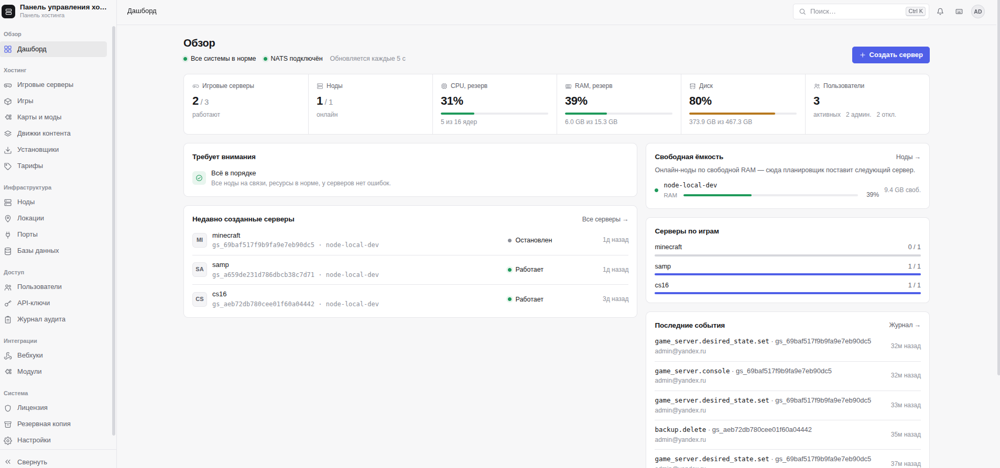

<div align="center">

# GameNodeX

**Self-hosted панель управления игровым хостингом.**
Подключайте ноды, продавайте игровые серверы под своим брендом, интегрируйте любой биллинг.

[](https://gamenodex.com/ru/?utm_source=github&utm_medium=readme)
[](https://gamenodex.com/signup?utm_source=github&utm_medium=readme)
[](https://gamenodex.com/ru/docs?utm_source=github&utm_medium=readme)

[Сайт](https://gamenodex.com/ru/?utm_source=github&utm_medium=readme) ·
[Начать бесплатно](https://gamenodex.com/signup?utm_source=github&utm_medium=readme) ·
[Документация](https://gamenodex.com/ru/docs?utm_source=github&utm_medium=readme) ·
[English](README.md)

</div>

<p align="center"></p>

---

## Зачем GameNodeX

Своя панель хостинга — это месяцы разработки. Место в чужом SaaS — это чужой бренд, чужие ограничения и данные ваших клиентов на чужих серверах. GameNodeX — третий путь: **готовая панель, которую вы ставите на своё железо.**

- 🏠 **Self-hosted** — ваша база данных, ваши ноды, ваш домен, ваши клиенты. Не SaaS и не реселлерский аккаунт.
- 🎨 **Только ваш бренд** — название, логотип, цвета, favicon, страница входа и ссылки на поддержку задаются в настройках. Клиенты не видят нашего имени.
- 🔌 **Любой биллинг** — документированный REST API (OpenAPI), подписанные вебхуки и готовый модуль WHMCS.
- 🧩 **Моды в один клик** — Modrinth, Steam Workshop, Thunderstore, uMod и GameBanana, с зависимостями и чистым удалением.
- 🔒 **Безопасность** — mTLS между панелью и каждой нодой, отдельные контейнеры и SFTP-chroot для серверов, 2FA, полный журнал действий.
- 🔓 **Без привязки к вендору** — обычные Docker-контейнеры, PostgreSQL и S3. Данные остаются в открытых форматах.

## Что такое «мастер»

GameNodeX состоит из двух частей:

```
            Ваша инфраструктура                            Наша сторона
┌────────────────────────────────────────────┐
│  Мастер-панель  (Linux-сервер + Docker)     │ ── только продление ──▶ Сервер лицензий
│  админка · панель клиента · REST API · БД   │        лицензии
└──────────────┬──────────────┬───────────────┘
          mTLS │         mTLS │
        ┌──────▼─────┐  ┌─────▼──────┐
        │  Нода  +   │  │  Нода  +   │   … любой дата-центр, любая страна
        │  агент     │  │  агент     │
        └────────────┘  └────────────┘
```

**Мастер** — это мозг вашего хостинга, сама панель. Ставится один раз на любой Linux-сервер с Docker:

- **Админка** для вашей команды: ноды, каталог игр, тарифы, клиенты, бэкапы, мониторинг, настройки.
- **Панель клиента** под вашим брендом: клиенты запускают и останавливают свои серверы, работают с живой консолью, файлами, SFTP, модами, бэкапами и расписанием.
- **REST API и вебхуки** для вашего биллинга или CRM.
- **Планировщик**, который размещает новые серверы на подходящих нодах по локации, свободным ресурсам и пулам портов и IP.
- **Центр сертификации** для нод: нода подключается по одноразовому токену, мастер сам выпускает и продлевает ей сертификат.
- **Каталог игр** с версиями: меняете настройки игры в одном месте — они сами доезжают до всех нод.

**Ноды** — ваши Linux-машины с Docker и лёгким агентом. Каждый игровой сервер — контейнер со своими лимитами CPU, памяти и диска. Ноды общаются только с вашим мастером, а не с нами.

## Возможности

| | |
|---|---|
| **Ноды** | Подключение по токену, автоматические mTLS-сертификаты, локации, пулы портов и IP, drain для обслуживания, текущая загрузка CPU/RAM/диска |
| **Игровые серверы** | Создание, запуск, остановка, переустановка; живая консоль, логи, статистика, файловый менеджер с редактором, SFTP, задачи по расписанию |
| **Каталог игр** | Любая игра с Docker-образом; версии настроек, автоматическая раскатка, **стартовый набор** готовых игр в один клик |
| **Моды и карты** | Modrinth, Steam Workshop, Thunderstore, uMod, GameBanana; зависимости, проверка совместимости, чистое удаление, загрузки клиентов с квотами |
| **Бэкапы** | Прямо с ноды в ваше S3-совместимое хранилище; несколько хранилищ по локациям и нодам; ротация и квоты в тарифе; дампы баз данных |
| **Базы данных** | MySQL / MariaDB / PostgreSQL для игровых серверов |
| **Мониторинг** | История CPU, памяти, диска и игроков по нодам и серверам; оповещения о недоступных нодах; метрики Prometheus |
| **Пользователи и доступ** | Роли и точные права сотрудников, совладельцы серверов, 2FA, журнал действий |
| **Биллинг** | Тарифы с лимитами ресурсов, приостановка за неуплату, REST API, вебхуки с подписью HMAC и повторами, модуль WHMCS |
| **Свой бренд** | Название, логотип, цвета, favicon, страница входа, светлая и тёмная темы — без пересборки |

## Поддерживаемые игры

В каталог можно добавить любую игру, которая запускается из Docker-образа. Для этих игр моды, карты и плагины уже настроены:

> Minecraft Java (Paper · Fabric · Forge) · Minecraft Bedrock · Counter-Strike 2 (CounterStrikeSharp · Workshop) · Counter-Strike 1.6 (AMX Mod X · GameBanana) · Counter-Strike: Source (SourceMod) · Rust (Oxide / uMod) · Garry's Mod · Valheim · V Rising · Risk of Rain 2 (BepInEx · Thunderstore) · Project Zomboid · Arma 3 · DayZ · Unturned · Space Engineers (Steam Workshop) · Terraria (tModLoader · TShock) · Factorio · SA-MP

## От голого железа до первого клиента

1. **Разверните мастер** на своём сервере одной командой и активируйте лицензионный ключ.
2. **Подключите ноды** — создайте токен в панели и запустите агент на каждой ноде. Сертификаты панель выдаст сама.
3. **Запустите серверы** — отметьте игры из стартового набора, задайте тарифы с лимитами; панель сама разместит серверы на подходящих нодах.
4. **Ведите бизнес** — ваш биллинг создаёт и приостанавливает серверы через API, клиенты управляют своими в вашей панели.

Пошаговая инструкция: **[gamenodex.com/ru/docs](https://gamenodex.com/ru/docs?utm_source=github&utm_medium=readme)**

## Цены

В каждом тарифе есть все возможности. Вы платите за масштаб: установки, ноды и игровые серверы.

| Тариф | Цена | Ноды | Игровые серверы |
|---|---|---|---|
| **Free** | $0 навсегда | 1 | 3 |
| **Starter** | $29 / мес | 3 | 50 |
| **Pro** | $79 / мес | 10 | 300 |
| **Business** | $199 / мес | 30 | 1000 |
| **Enterprise** | по запросу | без ограничений | без ограничений |

При оплате за год — 2 месяца бесплатно. Для бесплатного тарифа карта не нужна. Актуальные цены: **[gamenodex.com](https://gamenodex.com/ru/?utm_source=github&utm_medium=readme#pricing)**

## Вопросы и ответы

**Это SaaS?** Нет. У каждого покупателя своя установка. С нашим сервером панель связывается только чтобы продлить лицензию; телеметрия не собирается. Для закрытых сетей в Enterprise есть офлайн-лицензия.

**Что нужно для запуска?** Один Linux-сервер с Docker для мастера и Linux-машины с Docker для нод. По желанию — S3-совместимое хранилище для бэкапов (подойдёт и MinIO).

**Можно подключить свой биллинг?** Да — через REST API и вебхуки или готовым модулем WHMCS.

**Здесь есть исходный код?** Этот репозиторий — публичная страница проекта. Панель распространяется готовыми сборками с [gamenodex.com](https://gamenodex.com/ru/?utm_source=github&utm_medium=readme).

## Контакты

- 🌐 Сайт: [gamenodex.com](https://gamenodex.com/ru/?utm_source=github&utm_medium=readme)
- ✉️ Продажи и поддержка: [support@gamenodex.com](mailto:support@gamenodex.com)
- 🐞 Вопросы и пожелания: [Issues](../../issues)

<div align="center">

**[Начать бесплатно →](https://gamenodex.com/signup?utm_source=github&utm_medium=readme)**

Если GameNodeX вам пригодится, поставьте репозиторию ⭐ — так его найдут другие хостеры.

</div>
